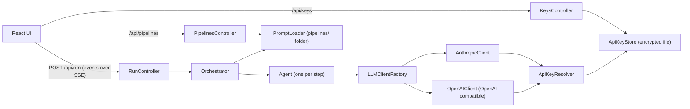
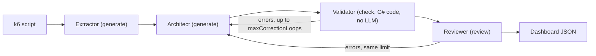

# Agent Controller

A small web app that runs a chain of LLM agents on a file. The included pipeline reads a k6 load test script and produces a Grafana dashboard for its metrics: one agent extracts the metrics, one designs the dashboard, a check written in C# verifies that the JSON can be imported into Grafana, and one agent reviews the result. Both the check and the review send the dashboard back for correction when they find errors.

Pipelines are plain files (a `pipeline.json` and one markdown prompt per agent), so the same engine can run other chains. It works with Anthropic and with any server that implements the OpenAI chat completions API.

This app is meant to run on your own computer. It has no login and only listens on `localhost`.

## Architecture



The default pipeline:



How a run works:

- Agents run in order. The first one receives the uploaded files. The next ones receive the files and the current main output.
- The `type` of each agent in `pipeline.json` decides what its answer means, never the shape of the answer:
  - `generate`: the answer becomes the main output.
  - `review`: the answer must be `{ "issues": [...], "suggestions": [...] }`. If an issue has the severity `error`, the run goes back to the closest `generate` agent before the reviewer, with the errors added to its input. This happens at most `maxCorrectionLoops` times.
  - `check`: no LLM and no prompt. A check written in C# (named by the `checker` field) examines the main output. Its problems are handled exactly like the errors of a review: same correction, same limit, and the limit is shared with the reviewer. If problems remain after the last correction, the run goes on and a warning is logged.
- If a provider has no key, or rejects the key (HTTP 401, 403 or 413), the agent uses the other provider with that provider's default model.
- Raw files larger than the provider limit are split into overlapping chunks for the first agent.
- You can set a breakpoint before an agent to pause the run, edit its prompt and continue.

## Stack

- ASP.NET Core (C#), no database
- React, TypeScript, Vite, Tailwind CSS
- xUnit for the tests

## Requirements

- .NET 10 SDK
- Node.js 18 or later
- An API key for Anthropic or for an OpenAI compatible server

## Run

```bash
cp appsettings.example.json appsettings.json
cd frontend && npm install && npm run build && cd ..
dotnet run
```

Open http://localhost:5000 (use `localhost`, other host names are refused).

For frontend development, run `npm run dev` in `frontend/` and open http://localhost:5173. It proxies `/api` to the backend.

### API keys

Never put a key in `appsettings.json` or in the code. Use one of these, listed from highest to lowest priority:

1. The **API keys** page in the app (key icon in the sidebar). You can save, test and delete a key. The key is sent once to the backend, encrypted with ASP.NET Core Data Protection and written to `data/api-keys.json`, which git ignores. The API never sends a key back to the browser, only whether it is configured and its last 4 characters. The Test button makes a light call to the provider (it lists models, it does not generate text).
2. An environment variable: `Anthropic__ApiKey` or `OpenAI__ApiKey`.
3. .NET user secrets:

```bash
dotnet user-secrets set "Anthropic:ApiKey" "<your key>"
dotnet user-secrets set "OpenAI:ApiKey" "<your key>"
```

The encryption keys are created by Data Protection in your user profile (`~/.aspnet/DataProtection-Keys`), outside the repository, so copying `data/api-keys.json` alone does not reveal a key. These keys are not encrypted themselves on macOS and Linux, so this protects against committing or sharing the file by mistake, not against another program running as your user.

### Providers and models

`appsettings.json` lists the models offered in the interface (`Models`), the provider and model each agent role starts with (`AgentConfigs`) and the default model of each provider. To use another OpenAI compatible server, for example a local Ollama, set `OpenAI:BaseUrl` (for example `http://localhost:11434/v1`), save any non-empty key for it and add its models to `Models`.

## Example

1. Start the app and select the pipeline **Grafana k6 Dashboard**.
2. Drop `samples/quickpizza-load-test.js` in the upload area. It is a k6 test against the public QuickPizza demo, with three custom metrics declared in `thresholds`.
3. Click Generate. The log shows each agent, the metrics found, the result of the check and of the review, and any correction loop.
4. Download the JSON and import it in Grafana (Dashboards, New, Import).

The dashboard assumes k6 sends its metrics to Prometheus with the remote write output, with these settings:

```bash
K6_PROMETHEUS_RW_TREND_STATS="med,p(90),p(95),p(99)" \
k6 run -o experimental-prometheus-rw --tag testname=quickpizza --tag testid=run-1 samples/quickpizza-load-test.js
```

The queries filter on the labels `testname` and `testid`, so keep the two `--tag` options.

## Pipelines

Each pipeline is a folder in `pipelines/` with a `pipeline.json` and one prompt file per agent. You can create and edit pipelines in the interface or by hand:

```json
{
  "name": "my-pipeline",
  "displayName": "My pipeline",
  "description": "What it does",
  "outputType": "json",
  "maxCorrectionLoops": 2,
  "agents": [
    { "role": "writer", "name": "Writer", "step": 1, "promptFile": "writer.md", "type": "generate" },
    { "role": "validator", "name": "Validator", "step": 2, "promptFile": "", "type": "check", "checker": "grafana-prometheus-dashboard" },
    { "role": "critic", "name": "Critic", "step": 3, "promptFile": "critic.md", "type": "review" }
  ]
}
```

Names use lowercase letters, digits and hyphens. The output type can be `text`, `json`, `html`, `csv` or `markdown`. The only checker available is `grafana-prometheus-dashboard`; it verifies valid JSON, the required fields (`uid`, `title`, `schemaVersion`, `panels`), positive unique panel ids, a `gridPos` inside the 24 column grid, a query on every target, datasource variables that are defined, and no `TODO`, `FIXME`, `XXX` or `{{PLACEHOLDER}}` left in the text. To add a checker, write a function that returns a list of problems and register it in `Services/Checkers.cs`.

## Tests

```bash
dotnet test
```

The tests use a fake LLM client and a fake HTTP handler, so they need no network and no API key. They cover the orchestrator (chaining, review and check correction loops, agent types, skipped agents, errors, chunking), the dashboard check (including the example dashboard written in the architect prompt), the agent (JSON extraction, retry, provider fallback), pipeline file safety, and the API keys (the key is never returned, deletion works, the file is encrypted, errors never contain the key).

## Limits and ideas

- No authentication: do not expose the port to a network.
- Run history only lives in the browser tab. Saving runs to disk would help.
- The pipeline creator and editor share a lot of code and could be one component.
- The input of later agents includes the original files, which costs more tokens on very large files.
- Chunked JSON objects are merged as an array, which only suits list outputs.
- Structured output or tool use would replace the JSON extraction from free text.

## License

MIT
